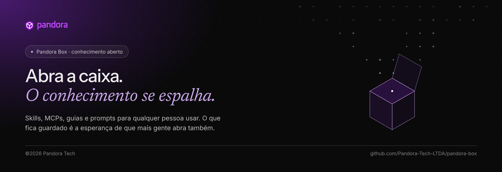
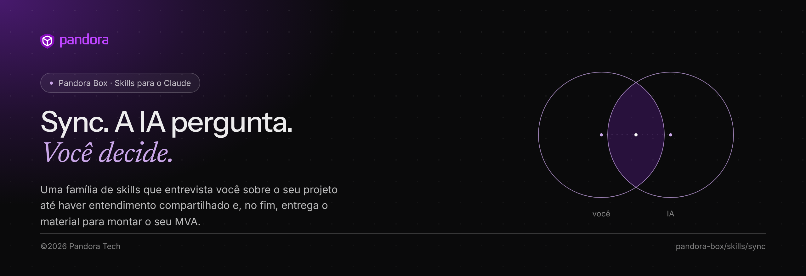
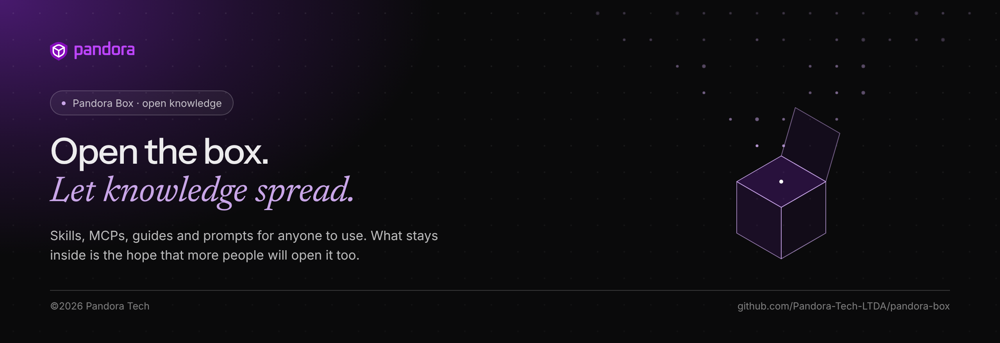
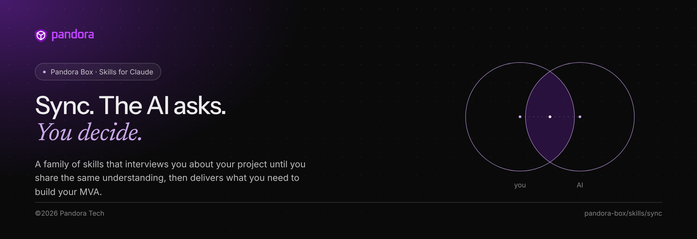

<div align="center">



<br>

**A caixa de conhecimento aberto da Pandora.**<br>
Skills, MCPs, guias e prompts para trabalhar com IA com critério, do primeiro passo ao uso avançado.

<br>

[](LICENSE)
[](LICENSE-CONTEUDO.md)
[](#english)
[](CONTRIBUTING.md)

**Português** · [English](#english)

[Produtos](#produtos) · [Instalação](#instalação) · [Organização](#como-o-repositório-está-organizado) · [Contribuir](#contribuir)

</div>

---

## Por que Pandora Box

No mito, Pandora abre a caixa e tudo o que havia dentro se espalha pelo mundo. Só a esperança fica guardada no fundo.

Aqui a caixa é aberta de propósito. O que sai dela é conhecimento: o que a Pandora aprende construindo com IA, organizado para que qualquer pessoa possa aplicar no próprio trabalho. O que fica guardado, dentro deste repositório, é a esperança de que mais pessoas abram a caixa também.

Todo o material é aberto. Leia, copie, adapte e use, citando a fonte.

---

## Produtos

<a href="skills/sync/"></a>

### Sync

**Skills que entrevistam você sobre o seu projeto antes de qualquer linha ser escrita.**

A maioria dos projetos com IA começa pela ferramenta. O Sync começa pelas perguntas: o que você quer resolver, para quem, com quais dados e com qual critério de sucesso. A IA pergunta em rodadas, sugere e mostra o custo de cada sugestão. As decisões ficam com você, e um "sim" sem motivo não fecha nenhuma delas.

No fim, você sai com o projeto documentado e, se quiser, com o material para montar um MVA: o prompt do agente com testes, os documentos de referência e o manual de montagem.

| Skill | O que faz | Situação |
|---|---|---|
| [`/sync-docs`](skills/sync/sync-docs/) | Entrevista sobre o projeto e registra glossário e decisões. **Ponto de partida.** | v0.1, em teste |
| [`/sync-mva`](skills/sync/sync-mva/) | Monta o MVA a partir do que o `/sync-docs` registrou | v0.1, em teste |
| [`/syncdb`](skills/sync/syncdb/) | Gera bases de dados sintéticas em CSV ou Markdown a partir de um arquivo de exemplo | v0.1, em teste |
| [`/sync-me`](skills/sync/sync-me/) | Entrevista sobre uma ideia ou projeto, sem gerar arquivos. É também o método de entrevista que as outras skills usam. | v0.1, em teste |

[Conhecer o Sync ↗](skills/sync/) · [Instalar](#instalação)

---

## Instalação

As skills seguem o formato aberto [Agent Skills](https://agentskills.io) e funcionam no Claude e em outros agentes compatíveis. Elas são escritas para o Claude; nas demais plataformas, o formato é compatível, mas o comportamento ainda não foi validado.

Downloads: [sync-me.zip](https://github.com/Pandora-Tech-LTDA/pandora-box/releases/download/skills/sync-me.zip) · [sync-docs.zip](https://github.com/Pandora-Tech-LTDA/pandora-box/releases/download/skills/sync-docs.zip) · [sync-mva.zip](https://github.com/Pandora-Tech-LTDA/pandora-box/releases/download/skills/sync-mva.zip) · [syncdb.zip](https://github.com/Pandora-Tech-LTDA/pandora-box/releases/download/skills/syncdb.zip) · [sync-todas.zip](https://github.com/Pandora-Tech-LTDA/pandora-box/releases/download/skills/sync-todas.zip) · [todos os arquivos](https://github.com/Pandora-Tech-LTDA/pandora-box/releases/tag/skills)

Clique na sua plataforma:

<details>
<summary><strong>Claude.ai (navegador, desktop e celular)</strong> · Suportado</summary>

1. **Baixe as skills.** [sync-me.zip](https://github.com/Pandora-Tech-LTDA/pandora-box/releases/download/skills/sync-me.zip) é obrigatória; baixe também [sync-docs.zip](https://github.com/Pandora-Tech-LTDA/pandora-box/releases/download/skills/sync-docs.zip), [sync-mva.zip](https://github.com/Pandora-Tech-LTDA/pandora-box/releases/download/skills/sync-mva.zip) e [syncdb.zip](https://github.com/Pandora-Tech-LTDA/pandora-box/releases/download/skills/syncdb.zip). Todos os arquivos ficam em [Skills da Pandora Box](https://github.com/Pandora-Tech-LTDA/pandora-box/releases/tag/skills).
2. **Ative a execução de código.** Em *Configurações → Capacidades*, ative a execução de código e criação de arquivos.
3. **Envie cada skill.** Ainda em *Configurações → Capacidades*, na área **Skills**, envie o .zip de cada skill. Se baixou o `sync-todas.zip`, abra-o antes: o Claude espera um .zip por skill.
4. **Teste.** Em uma nova conversa, escreva: *"Use a skill sync-me para me ajudar a amadurecer a ideia de um agente que analisa a frequência dos funcionários."*

As skills enviadas no Claude.ai ficam na sua conta e valem também no Cowork. Os nomes dos menus podem mudar; se não encontrar, pergunte ao próprio Claude onde ficam as skills nas configurações.

</details>

<details>
<summary><strong>Claude Cowork</strong> · Suportado</summary>

O Cowork usa as skills da sua conta do Claude. Se você já instalou pelo Claude.ai, não precisa fazer nada.

1. **Baixe as skills.** [sync-me.zip](https://github.com/Pandora-Tech-LTDA/pandora-box/releases/download/skills/sync-me.zip) é obrigatória; baixe também [sync-docs.zip](https://github.com/Pandora-Tech-LTDA/pandora-box/releases/download/skills/sync-docs.zip), [sync-mva.zip](https://github.com/Pandora-Tech-LTDA/pandora-box/releases/download/skills/sync-mva.zip) e [syncdb.zip](https://github.com/Pandora-Tech-LTDA/pandora-box/releases/download/skills/syncdb.zip). Todos os arquivos ficam em [Skills da Pandora Box](https://github.com/Pandora-Tech-LTDA/pandora-box/releases/tag/skills).
2. **Envie cada skill.** Em *Configurações → Capacidades → Skills*, envie o .zip de cada skill, com a execução de código ativada.
3. **Teste.** Abra o Cowork numa pasta de projeto e digite `/` no chat: as skills instaladas aparecem na lista.

Como o Cowork trabalha numa pasta do seu computador, o `/sync-docs` grava o glossário e as decisões em `sync/`, e o `/sync-mva` grava os arquivos do MVA na mesma pasta.

</details>

<details>
<summary><strong>Claude Code</strong> · Suportado</summary>

Abra o Claude Code em qualquer pasta, copie o prompt e cole no chat:

```text
Instale para mim as skills da família "sync" do repositório público https://github.com/Pandora-Tech-LTDA/pandora-box (branch main, pasta skills/sync).

Cada subpasta de skills/sync que tem um arquivo SKILL.md é uma skill. Ignore a pasta "references".

Copie cada uma dessas subpastas, inteira, para ~/.claude/skills/<nome-da-subpasta>/. Se alguma já existir, me pergunte antes de substituir.

Apague os arquivos temporários do download. No final, me mostre uma tabela com as skills instaladas e o que cada uma faz, e me diga como começar a usar.
```

O Claude pode pedir permissão para rodar comandos. Leia e aprove. Depois, reinicie o Claude Code e digite `/`: as skills instaladas aparecem na lista.

**Só para um projeto:** troque `~/.claude/skills/` por `.claude/skills/` no prompt, com o Claude Code aberto na pasta do projeto.

</details>

<details>
<summary><strong>OpenAI Codex (CLI, extensão de IDE e app do ChatGPT)</strong> · Compatível, não testado</summary>

O Codex lê skills no formato Agent Skills. Segundo a [documentação do Codex](https://developers.openai.com/codex/skills), as skills do usuário ficam em `~/.agents/skills/` e as de um projeto em `.agents/skills/` na raiz do repositório. Abra o Codex, copie o prompt e cole no chat:

```text
Instale para mim as skills da família "sync" do repositório público https://github.com/Pandora-Tech-LTDA/pandora-box (branch main, pasta skills/sync).

Cada subpasta de skills/sync que tem um arquivo SKILL.md é uma skill. Ignore a pasta "references".

Copie cada uma dessas subpastas, inteira, para ~/.agents/skills/<nome-da-subpasta>/. Se alguma já existir, me pergunte antes de substituir.

Apague os arquivos temporários do download. No final, me mostre uma tabela com as skills instaladas e o que cada uma faz, e me diga como começar a usar.
```

O Codex detecta skills novas sozinho. Se alguma não aparecer, reinicie.

**Atenção:** as skills foram escritas para o Claude. No Codex, o comportamento pode variar, principalmente quando uma skill chama outra (as portas do Sync chamam a `sync-me`).

</details>

<details>
<summary><strong>VS Code com GitHub Copilot</strong> · Compatível, não testado</summary>

Segundo o [guia do padrão Agent Skills](https://agentskills.io/skill-creation/quickstart), o VS Code procura skills em `.agents/skills/` na raiz do projeto. Abra a pasta do projeto, abra o chat do Copilot em **modo agente**, copie o prompt e cole:

```text
Instale para mim as skills da família "sync" do repositório público https://github.com/Pandora-Tech-LTDA/pandora-box (branch main, pasta skills/sync).

Cada subpasta de skills/sync que tem um arquivo SKILL.md é uma skill. Ignore a pasta "references".

Copie cada uma dessas subpastas, inteira, para .agents/skills/ (na raiz deste projeto) <nome-da-subpasta>/. Se alguma já existir, me pergunte antes de substituir.

Apague os arquivos temporários do download. No final, me mostre uma tabela com as skills instaladas e o que cada uma faz, e me diga como começar a usar.
```

Depois, digite `/skills` no chat do modo agente para conferir se elas aparecem.

**Atenção:** as skills foram escritas para o Claude. No Copilot, o comportamento pode variar.

</details>

<details>
<summary><strong>Outros agentes compatíveis com Agent Skills</strong> · Compatível, não testado</summary>

[Agent Skills](https://agentskills.io) é um formato aberto adotado por outros agentes. Os locais mais comuns são `.agents/skills/` na raiz do projeto (só aquele projeto) e `~/.agents/skills/` (todos os projetos). Alguns agentes usam uma pasta própria, como `.<nome-do-agente>/skills/`, ou também leem `.claude/skills/`. Confira a documentação do seu agente.

- **Manual:** baixe o .zip de cada skill em [Skills da Pandora Box](https://github.com/Pandora-Tech-LTDA/pandora-box/releases/tag/skills), descompacte e coloque a pasta da skill (por exemplo, `sync-me/`, com o `SKILL.md` dentro) no local indicado.
- **Por prompt:** se o seu agente roda comandos, use o prompt do Codex, trocando a pasta de destino pela do seu agente.

</details>

Os mesmos passos, com solução de problemas, estão em [Como instalar as skills](guias/como-instalar-skills.md).

---

## Como o repositório está organizado

| Pasta | Conteúdo |
|---|---|
| [`skills/`](skills/) | Skills: instruções empacotadas para tarefas recorrentes |
| [`mcps/`](mcps/) | Servidores MCP (Model Context Protocol), com instalação e uso |
| [`guias/`](guias/) | Tutoriais passo a passo, do básico ao avançado |
| [`dicas/`](dicas/) | Dicas curtas e boas práticas |
| [`prompts/`](prompts/) | Prompts testados, prontos para adaptar |
| [`recursos/`](recursos/) | Ferramentas, leituras e referências recomendadas |

**Por onde começar.** Se você nunca usou uma skill, abra a sua plataforma em [Instalação](#instalação). Se nunca ouviu falar de MCP, leia [O que é MCP](guias/o-que-e-mcp.md).

---

## Contribuir

Encontrou um erro, tem uma dúvida ou quer sugerir um conteúdo? Abra uma [issue](../../issues/new/choose). Para contribuir com material, leia o [guia de contribuição](CONTRIBUTING.md).

## Licença

- **Código** (MCPs, scripts e exemplos): [MIT](LICENSE).
- **Conteúdo** (textos, guias e dicas): [CC BY 4.0](LICENSE-CONTEUDO.md). Use à vontade, citando a fonte.

---
---

<a id="english"></a>

<div align="center">



**English** · [Português](#por-que-pandora-box)

</div>

## Pandora Box

**Pandora's open knowledge box.** Skills, MCPs, guides and prompts for working with AI with sound judgment, from first steps to advanced use. Most material is written in Brazilian Portuguese; the skills work in any language.

### Why Pandora Box

In the myth, Pandora opens the box and everything inside spreads across the world. Only hope remains at the bottom.

Here the box is opened on purpose. What comes out is knowledge: what Pandora learns building with AI, organized so anyone can apply it to their own work. What stays inside this repository is the hope that more people will open the box too.

Everything here is open. Read, copy, adapt and use it, with attribution.

### Products

<a href="skills/sync/README.md#english"></a>

#### Sync

**Skills that interview you about your project before a single line is written.**

Most AI projects start with the tool. Sync starts with questions: what you want to solve, for whom, with which data and with which success criteria. The AI asks in rounds, makes suggestions and shows what each suggestion costs. You make the decisions, and a "yes" without a reason closes none of them.

You end up with a documented project and, if you want, everything you need to build an MVA (Minimum Viable Automation): the agent prompt with tests, reference documents and a setup manual.

| Skill | What it does | Status |
|---|---|---|
| [`/sync-docs`](skills/sync/sync-docs/) | Interviews you about the project and records a glossary and decisions. **Start here.** | v0.1, testing |
| [`/sync-mva`](skills/sync/sync-mva/) | Builds the MVA from what `/sync-docs` recorded | v0.1, testing |
| [`/syncdb`](skills/sync/syncdb/) | Generates synthetic datasets in CSV or Markdown from a sample file | v0.1, testing |
| [`/sync-me`](skills/sync/sync-me/) | Interview about an idea or project, no files created. It is also the interview method the other skills use. | v0.1, testing |

[Learn about Sync ↗](skills/sync/README.md#english)

### Installation

The skills follow the open [Agent Skills](https://agentskills.io) format and work in Claude and other compatible agents. They are written for Claude; on other platforms the format is compatible, but behavior has not been validated yet.

Downloads: [sync-me.zip](https://github.com/Pandora-Tech-LTDA/pandora-box/releases/download/skills/sync-me.zip) · [sync-docs.zip](https://github.com/Pandora-Tech-LTDA/pandora-box/releases/download/skills/sync-docs.zip) · [sync-mva.zip](https://github.com/Pandora-Tech-LTDA/pandora-box/releases/download/skills/sync-mva.zip) · [syncdb.zip](https://github.com/Pandora-Tech-LTDA/pandora-box/releases/download/skills/syncdb.zip) · [sync-todas.zip](https://github.com/Pandora-Tech-LTDA/pandora-box/releases/download/skills/sync-todas.zip) (all Sync skills) · [all files](https://github.com/Pandora-Tech-LTDA/pandora-box/releases/tag/skills)

Click your platform:

<details>
<summary><strong>Claude.ai (web, desktop and mobile)</strong> · Supported</summary>

1. **Download the skills.** [sync-me.zip](https://github.com/Pandora-Tech-LTDA/pandora-box/releases/download/skills/sync-me.zip) is required; also download [sync-docs.zip](https://github.com/Pandora-Tech-LTDA/pandora-box/releases/download/skills/sync-docs.zip), [sync-mva.zip](https://github.com/Pandora-Tech-LTDA/pandora-box/releases/download/skills/sync-mva.zip) and [syncdb.zip](https://github.com/Pandora-Tech-LTDA/pandora-box/releases/download/skills/syncdb.zip). All files are on [Pandora Box Skills](https://github.com/Pandora-Tech-LTDA/pandora-box/releases/tag/skills).
2. **Turn on code execution.** In *Settings → Capabilities*, turn on code execution and file creation.
3. **Upload each skill.** Still in *Settings → Capabilities*, in the **Skills** section, upload the .zip of each skill. If you downloaded `sync-todas.zip`, unzip it first: Claude expects one .zip per skill.
4. **Test it.** In a new conversation, write: *"Use the sync-me skill to help me refine the idea of an agent that analyzes employee attendance."*

Skills uploaded to Claude.ai belong to your account and also work in Cowork. Menu names may change; if you can't find them, ask Claude where skills are in the settings.

</details>

<details>
<summary><strong>Claude Cowork</strong> · Supported</summary>

Cowork uses the skills in your Claude account. If you already installed them through Claude.ai, there is nothing else to do.

1. **Download the skills.** [sync-me.zip](https://github.com/Pandora-Tech-LTDA/pandora-box/releases/download/skills/sync-me.zip) is required; also download [sync-docs.zip](https://github.com/Pandora-Tech-LTDA/pandora-box/releases/download/skills/sync-docs.zip), [sync-mva.zip](https://github.com/Pandora-Tech-LTDA/pandora-box/releases/download/skills/sync-mva.zip) and [syncdb.zip](https://github.com/Pandora-Tech-LTDA/pandora-box/releases/download/skills/syncdb.zip). All files are on [Pandora Box Skills](https://github.com/Pandora-Tech-LTDA/pandora-box/releases/tag/skills).
2. **Upload each skill.** In *Settings → Capabilities → Skills*, upload the .zip of each skill, with code execution turned on.
3. **Test it.** Open Cowork in a project folder and type `/` in the chat: installed skills show up in the list.

Because Cowork works inside a folder on your computer, `/sync-docs` saves the glossary and decisions to `sync/`, and `/sync-mva` saves the MVA files to the same folder.

</details>

<details>
<summary><strong>Claude Code</strong> · Supported</summary>

Open Claude Code in any folder, copy the prompt and paste it into the chat:

```text
Install the "sync" skill family from the public repository https://github.com/Pandora-Tech-LTDA/pandora-box (branch main, folder skills/sync).

Each subfolder of skills/sync that contains a SKILL.md file is a skill. Ignore the "references" folder.

Copy each of these subfolders, in full, to ~/.claude/skills/<subfolder-name>/. If any already exists, ask me before replacing it.

Delete the temporary download files. At the end, show me a table of the installed skills and what each one does, and tell me how to get started.
```

Claude may ask for permission to run commands. Read and approve them. Then restart Claude Code and type `/`: installed skills show up in the list.

**For a single project:** replace `~/.claude/skills/` with `.claude/skills/` in the prompt, with Claude Code open in the project folder.

</details>

<details>
<summary><strong>OpenAI Codex (CLI, IDE extension and ChatGPT app)</strong> · Compatible, not tested</summary>

Codex reads skills in the Agent Skills format. According to the [Codex documentation](https://developers.openai.com/codex/skills), user skills live in `~/.agents/skills/` and project skills in `.agents/skills/` at the repository root. Open Codex, copy the prompt and paste it into the chat:

```text
Install the "sync" skill family from the public repository https://github.com/Pandora-Tech-LTDA/pandora-box (branch main, folder skills/sync).

Each subfolder of skills/sync that contains a SKILL.md file is a skill. Ignore the "references" folder.

Copy each of these subfolders, in full, to ~/.agents/skills/<subfolder-name>/. If any already exists, ask me before replacing it.

Delete the temporary download files. At the end, show me a table of the installed skills and what each one does, and tell me how to get started.
```

Codex picks up new skills automatically. If one doesn't show up, restart it.

**Note:** these skills were written for Claude. In Codex, behavior may differ, especially when one skill calls another (the Sync entry points call `sync-me`).

</details>

<details>
<summary><strong>VS Code with GitHub Copilot</strong> · Compatible, not tested</summary>

According to the [Agent Skills quickstart](https://agentskills.io/skill-creation/quickstart), VS Code looks for skills in `.agents/skills/` at the project root. Open the project folder, open the Copilot chat in **agent mode**, copy the prompt and paste it:

```text
Install the "sync" skill family from the public repository https://github.com/Pandora-Tech-LTDA/pandora-box (branch main, folder skills/sync).

Each subfolder of skills/sync that contains a SKILL.md file is a skill. Ignore the "references" folder.

Copy each of these subfolders, in full, to .agents/skills/ (at the root of this project) <subfolder-name>/. If any already exists, ask me before replacing it.

Delete the temporary download files. At the end, show me a table of the installed skills and what each one does, and tell me how to get started.
```

Then type `/skills` in agent mode chat to check that they show up.

**Note:** these skills were written for Claude. In Copilot, behavior may differ.

</details>

<details>
<summary><strong>Other Agent Skills–compatible agents</strong> · Compatible, not tested</summary>

[Agent Skills](https://agentskills.io) is an open format adopted by other agents. The most common locations are `.agents/skills/` at the project root (that project only) and `~/.agents/skills/` (all projects). Some agents use their own folder, such as `.<agent-name>/skills/`, or also read `.claude/skills/`. Check your agent's documentation.

- **Manually:** download each skill's .zip from [Pandora Box Skills](https://github.com/Pandora-Tech-LTDA/pandora-box/releases/tag/skills), unzip it and place the skill folder (for example, `sync-me/`, with `SKILL.md` inside) in that location.
- **With a prompt:** if your agent can run commands, use the Codex prompt and change the destination folder to your agent's.

</details>

The same steps, with troubleshooting, are in [How to install the skills](guias/como-instalar-skills.md#english).

### Repository layout

| Folder | Contents |
|---|---|
| [`skills/`](skills/) | Skills: packaged instructions for recurring tasks |
| [`mcps/`](mcps/) | MCP (Model Context Protocol) servers, with setup and usage |
| [`guias/`](guias/) | Step-by-step guides, from basic to advanced |
| [`dicas/`](dicas/) | Short tips and good practices |
| [`prompts/`](prompts/) | Tested prompts, ready to adapt |
| [`recursos/`](recursos/) | Recommended tools, reading and references |

### Contributing

Found a mistake, have a question or want to suggest content? Open an [issue](../../issues/new/choose). To contribute material, read the [contribution guide](CONTRIBUTING.md).

### License

- **Code** (MCPs, scripts and examples): [MIT](LICENSE).
- **Content** (texts, guides and tips): [CC BY 4.0](LICENSE-CONTEUDO.md). Free to use with attribution.

<sub>©2026 Pandora Tech LTDA</sub>
