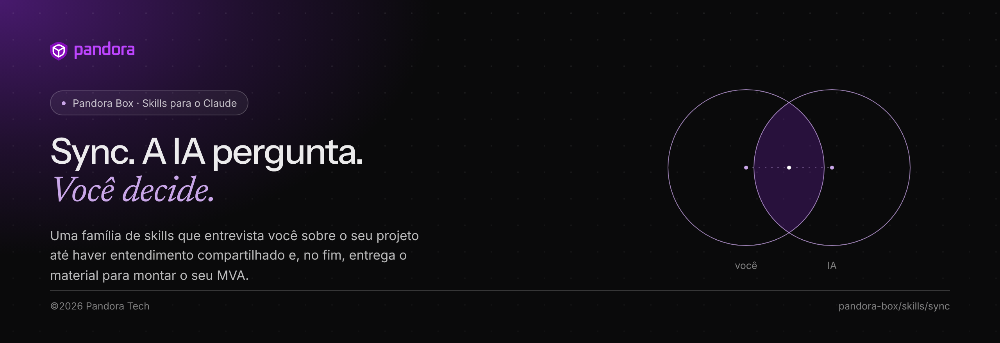

# Pandora Box

**Português** · [English](#english)

Skills abertas da Pandora para trabalhar com IA com critério. Este plugin reúne todas as skills da [Pandora Box](https://github.com/Pandora-Tech-LTDA/pandora-box) num só pacote e é atualizado a cada nova versão.

## Família Sync

Skills que entrevistam você sobre o seu projeto antes de qualquer linha ser escrita. A IA pergunta em rodadas, sugere e mostra o que cada sugestão custa. As decisões ficam com você, e nas que importam um "sim" sem motivo não basta.

| Skill | Para quê |
|---|---|
| `/pandora:sync-docs` | Entender e documentar um projeto, registrando glossário e decisões. **Comece por aqui.** |
| `/pandora:sync-spec` | Montar a spec de um produto com telas para uma IA de código construir com segurança: propósito, estado de pronto, acesso e segurança, telas, arquitetura, padrão visual e plano de etapas. |
| `/pandora:sync-mva` | Montar um MVA a partir do registro do `/pandora:sync-docs`: prompt do agente com autoteste, documentos de referência e manual de montagem no Cowork. |
| `/pandora:syncdb` | Criar dados sintéticos em CSV ou Markdown a partir de um arquivo de exemplo, sem expor dados reais. |
| `/pandora:sync-me` | Amadurecer uma ideia, sem gerar arquivos. É também o método de entrevista das outras skills. |

**Fluxo recomendado:**

```
/pandora:sync-me (opcional) → /pandora:sync-docs → /pandora:sync-spec  (produto com telas)
                                 → /pandora:sync-mva → /pandora:syncdb  (automação ou agente)
```

Páginas de cada skill: [sync-me](https://github.com/Pandora-Tech-LTDA/pandora-box/tree/main/skills/sync/sync-me) · [sync-docs](https://github.com/Pandora-Tech-LTDA/pandora-box/tree/main/skills/sync/sync-docs) · [sync-spec](https://github.com/Pandora-Tech-LTDA/pandora-box/tree/main/skills/sync/sync-spec) · [sync-mva](https://github.com/Pandora-Tech-LTDA/pandora-box/tree/main/skills/sync/sync-mva) · [syncdb](https://github.com/Pandora-Tech-LTDA/pandora-box/tree/main/skills/sync/syncdb).

**Exemplo:** você quer um agente que analise a frequência dos funcionários. O `/pandora:sync-docs` esclarece a dor, quem usa a análise e quais regras de ponto valem. O `/pandora:sync-mva` define que o agente precisa de uma planilha de frequência e da política de ponto e escreve o prompt com casos de teste. O `/pandora:syncdb` cria uma planilha fictícia com os mesmos campos da real. Se depois virar um produto com telas, o `/pandora:sync-spec` escreve a spec para uma IA de código construir.

**Situação:** em teste. `sync-me` na versão 0.2; as demais na 0.1.

## Instalação

- **Claude.ai e Cowork:** baixe [pandora.zip](https://github.com/Pandora-Tech-LTDA/pandora-box/releases/download/skills/pandora.zip) e envie em *Personalizar → Plugins → Adicionar → Enviar plugin*.
- **Claude Code:** `/plugin install pandora --marketplace Pandora-Tech-LTDA/pandora-box`.
- **Outras plataformas:** veja [Como instalar as skills](https://github.com/Pandora-Tech-LTDA/pandora-box/blob/main/guias/como-instalar-skills.md).

## Créditos e licença

`sync-me` e `sync-docs` são derivadas das skills `grilling`, `grill-me` e `grill-with-docs` de Matt Pocock ([mattpocock/skills](https://github.com/mattpocock/skills), licença MIT). `sync-spec` aproveita ideias de `to-spec` (Matt Pocock, MIT), `wireframes` (ba-toolkit, MIT) e `aidlc-requirements` (AWS, MIT-0). `sync-mva` e `syncdb` seguem a metodologia MVA, ©2026 Pandora Tech LTDA. Código sob licença MIT.

---

<a id="english"></a>

# Pandora Box

**English** · [Português](#pandora-box)

Pandora's open skills for working with AI with sound judgment. This plugin bundles every [Pandora Box](https://github.com/Pandora-Tech-LTDA/pandora-box) skill in one package and is updated with each new version.

## Sync family

Skills that interview you about your project before a single line is written. The AI asks in rounds, makes suggestions and shows what each suggestion costs. You make the decisions, and on the ones that matter a "yes" without a reason is not enough.

| Skill | Purpose |
|---|---|
| `/pandora:sync-docs` | Understand and document a project, recording a glossary and decisions. **Start here.** |
| `/pandora:sync-spec` | Build the spec of a product with screens so a coding AI can build it safely: purpose, done state, access and security, screens, architecture, visual standard and step plan. |
| `/pandora:sync-mva` | Build an MVA (Minimum Viable Automation) from the `/pandora:sync-docs` record: agent prompt with self-test, reference documents and a Cowork setup manual. |
| `/pandora:syncdb` | Create synthetic data in CSV or Markdown from a sample file, without exposing real data. |
| `/pandora:sync-me` | Develop an idea, without creating files. It is also the interview method for the other skills. |

**Recommended flow:**

```
/pandora:sync-me (optional) → /pandora:sync-docs → /pandora:sync-spec  (product with screens)
                                 → /pandora:sync-mva → /pandora:syncdb  (automation or agent)
```

Skill pages: [sync-me](https://github.com/Pandora-Tech-LTDA/pandora-box/tree/main/skills/sync/sync-me#english) · [sync-docs](https://github.com/Pandora-Tech-LTDA/pandora-box/tree/main/skills/sync/sync-docs#english) · [sync-spec](https://github.com/Pandora-Tech-LTDA/pandora-box/tree/main/skills/sync/sync-spec#english) · [sync-mva](https://github.com/Pandora-Tech-LTDA/pandora-box/tree/main/skills/sync/sync-mva#english) · [syncdb](https://github.com/Pandora-Tech-LTDA/pandora-box/tree/main/skills/sync/syncdb#english)

**Example:** you want an agent that analyzes employee attendance. `/pandora:sync-docs` clarifies the pain point, who uses the analysis and which timekeeping rules apply, and recommends `/pandora:sync-mva`. `/pandora:sync-mva` determines that the agent needs an attendance spreadsheet and the timekeeping policy and writes the prompt with test cases. `/pandora:syncdb` creates a fictional spreadsheet with the same fields as the real one. If it later becomes a product with screens, `/pandora:sync-spec` writes the spec for a coding AI to build it.

The skills are written in Brazilian Portuguese and work in any language.

**Status:** in testing. `sync-me` at version 0.2; the others at 0.1.

## Installation

- **Claude.ai and Cowork:** download [pandora.zip](https://github.com/Pandora-Tech-LTDA/pandora-box/releases/download/skills/pandora.zip) and upload it in *Customize → Plugins → Add → Upload plugin*.
- **Claude Code:** `/plugin install pandora --marketplace Pandora-Tech-LTDA/pandora-box`.
- **Other platforms:** see [How to install the skills](https://github.com/Pandora-Tech-LTDA/pandora-box/blob/main/guias/como-instalar-skills.md#english).

## Credits and license

`sync-me` and `sync-docs` are derived from Matt Pocock's `grilling`, `grill-me` and `grill-with-docs` skills ([mattpocock/skills](https://github.com/mattpocock/skills), MIT license). `sync-spec` draws on ideas from `to-spec` (Matt Pocock, MIT), `wireframes` (ba-toolkit, MIT) and `aidlc-requirements` (AWS, MIT-0). `sync-mva` and `syncdb` follow the MVA methodology, ©2026 Pandora Tech LTDA. Code under the MIT license.

<sub>©2026 Pandora Tech LTDA</sub>
