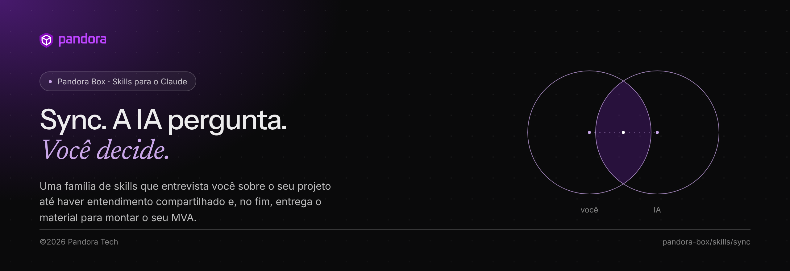
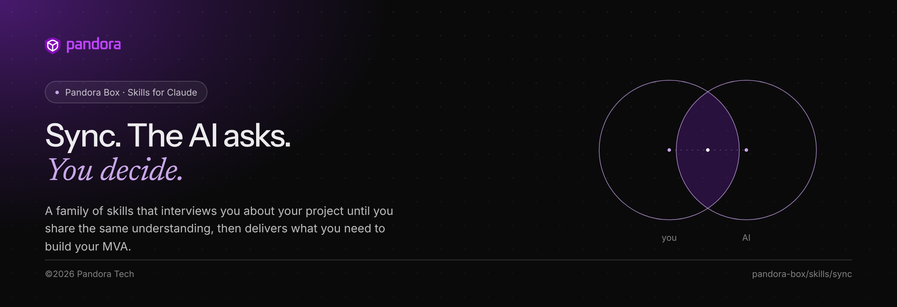

# Sync

**Português** · [English](#english)

**Skills para o Claude que entrevistam você sobre o seu projeto antes de qualquer linha ser escrita.**

A maioria dos projetos com IA começa pela ferramenta e descobre o problema no meio do caminho. O Sync inverte a ordem: primeiro vêm as perguntas, depois a construção.

> **Situação.** A `syncing`, o método de entrevista, está na versão 0.1, em teste. As demais skills estão em construção.

---

## Como funciona

**A IA pergunta em rodadas.** O projeto é tratado como uma árvore de decisões. Em cada rodada, a IA faz todas as perguntas que já podem ser respondidas e espera as suas respostas antes de seguir. Cada resposta libera as perguntas seguintes.

**Cada sugestão mostra o que custa.** A IA recomenda um caminho e diz o que se perde com ele. Assim você tem um motivo concreto para concordar ou discordar. Se preferir pensar sem influência, peça para esconder as sugestões.

**As decisões são suas.** Um "sim" sem motivo não fecha uma decisão. Se você aceitar tudo em uma rodada, a próxima começa com um desafio. Discordar é parte do método.

**Os fatos são da IA.** O que dá para descobrir nos seus arquivos ou documentos, a IA pesquisa sozinha e mostra onde encontrou.

**Nada é construído sem confirmação.** A sessão termina com um resumo do entendimento compartilhado. Só depois do seu aceite a IA passa para a próxima etapa.

---

## As skills

| Skill | Para quê | Entrega | Situação |
|---|---|---|---|
| `/sync-docs` | Entender e documentar um projeto. **Comece por aqui.** | `sync/glossario.md` e `sync/decisoes.md` no seu projeto, ou um registro no chat | Em construção |
| `/sync-mva` | Montar um MVA a partir do registro do `/sync-docs` | Prompt do agente com testes automatizados, documentos de referência e manual de montagem no Cowork | Em construção |
| `/syncdb` | Criar dados de exemplo sem expor dados reais | Bases sintéticas em CSV ou Markdown, a partir de um arquivo de exemplo | Em construção |
| `/sync-me` | Amadurecer uma ideia solta, sem gerar arquivos | Resumo com decisões, discordâncias e perguntas em aberto | Em construção |
| [`syncing`](syncing/) | O método de entrevista usado pelas outras skills | Não é chamada diretamente | v0.1, em teste |

### O fluxo recomendado

```
/sync-docs  →  /sync-mva  →  /syncdb
```

1. **`/sync-docs`** entrevista você sobre o processo que quer resolver e registra o vocabulário e as decisões.
2. **`/sync-mva`** parte desse registro, completa só o que falta e entrega o material para montar o MVA.
3. **`/syncdb`** gera os dados sintéticos de que o MVA precisa para ser testado com segurança.

**Exemplo.** Você quer um agente que analise a frequência dos funcionários. O `/sync-docs` esclarece qual é a dor, quem usa a análise e quais regras de ponto valem. O `/sync-mva` define que o agente precisa de uma planilha de frequência e da política de ponto, e escreve o prompt com casos de teste. O `/syncdb` cria uma planilha de frequência fictícia, com os mesmos campos da real.

---

## Instalação

Funciona no Claude.ai, no Claude Cowork e no Claude Code, e é compatível com o OpenAI Codex, o VS Code com GitHub Copilot e outros agentes que leem o formato Agent Skills.

Escolha a sua plataforma em [Como instalar as skills](../../guias/como-instalar-skills.md). Para o Claude.ai e o Cowork, o download direto é [syncing.zip](https://github.com/Pandora-Tech-LTDA/pandora-box/releases/download/skills/syncing.zip).

---

## Créditos e licenças

- `syncing`, `/sync-me` e `/sync-docs` são derivadas das skills [`grilling`](https://www.aihero.dev/skills-grilling), [`grill-me`](https://www.aihero.dev/skills-grill-me) e [`grill-with-docs`](https://www.aihero.dev/skills-grill-with-docs) de **Matt Pocock** ([mattpocock/skills](https://github.com/mattpocock/skills), licença MIT; cópia em [`references/mattpocock-skills/LICENSE`](references/mattpocock-skills/LICENSE)).
- `/sync-mva` e `/syncdb` seguem a metodologia MVA, ©2026 Pandora Tech LTDA ([`references/mva/FONTE.md`](references/mva/FONTE.md)).

## Para quem mantém o projeto

- [`DECISOES.md`](DECISOES.md): decisões de produto e de método.
- [`references/`](references/): material de origem.

---
---

<a id="english"></a>



# Sync

**English** · [Português](#sync)

**Skills that interview you about your project before a single line is written.**

Most AI projects start with the tool and discover the problem halfway through. Sync reverses the order: questions first, building second.

> **Status.** `syncing`, the interview method, is at version 0.1, in testing. The other skills are in progress.

## How it works

**The AI asks in rounds.** The project is treated as a decision tree. In each round, the AI asks every question that can already be answered and waits for your answers before moving on. Each answer unlocks the next questions.

**Every suggestion shows its cost.** The AI recommends a path and says what you give up with it, so you have a concrete reason to agree or disagree. If you prefer to think without influence, ask it to hide the suggestions.

**Decisions are yours.** A "yes" without a reason doesn't close a decision. If you accept everything in a round, the next one opens with a challenge. Disagreeing is part of the method.

**Facts are the AI's job.** Whatever can be found in your files or documents, the AI looks up on its own and shows you where it found it.

**Nothing gets built without confirmation.** The session ends with a summary of the shared understanding. Only after you agree does the AI move to the next step.

## The skills

| Skill | Purpose | Output | Status |
|---|---|---|---|
| `/sync-docs` | Understand and document a project. **Start here.** | `sync/glossario.md` and `sync/decisoes.md` in your project, or a record in the chat | In progress |
| `/sync-mva` | Build an MVA (Minimum Viable Automation) from the `/sync-docs` record | Agent prompt with automated tests, reference documents and a Cowork setup manual | In progress |
| `/syncdb` | Create sample data without exposing real data | Synthetic datasets in CSV or Markdown, from a sample file | In progress |
| `/sync-me` | Develop a loose idea, without creating files | Summary of decisions, disagreements and open questions | In progress |
| [`syncing`](syncing/) | The interview method used by the other skills | Not called directly | v0.1, testing |

### Recommended flow

```
/sync-docs  →  /sync-mva  →  /syncdb
```

1. **`/sync-docs`** interviews you about the process you want to solve and records its vocabulary and decisions.
2. **`/sync-mva`** starts from that record, fills only the gaps and delivers what you need to build the MVA.
3. **`/syncdb`** generates the synthetic data the MVA needs to be tested safely.

**Example.** You want an agent that analyzes employee attendance. `/sync-docs` clarifies the pain point, who uses the analysis and which timekeeping rules apply. `/sync-mva` determines that the agent needs an attendance spreadsheet and the timekeeping policy, and writes the prompt with test cases. `/syncdb` creates a fictional attendance spreadsheet with the same fields as the real one.

## Installation

Works on Claude.ai, Claude Cowork and Claude Code, and is compatible with OpenAI Codex, VS Code with GitHub Copilot and other agents that read the Agent Skills format.

Pick your platform in [How to install the skills](../../guias/como-instalar-skills.md#english). For Claude.ai and Cowork, the direct download is [syncing.zip](https://github.com/Pandora-Tech-LTDA/pandora-box/releases/download/skills/syncing.zip).

## Credits and licenses

- `syncing`, `/sync-me` and `/sync-docs` are derived from the [`grilling`](https://www.aihero.dev/skills-grilling), [`grill-me`](https://www.aihero.dev/skills-grill-me) and [`grill-with-docs`](https://www.aihero.dev/skills-grill-with-docs) skills by **Matt Pocock** ([mattpocock/skills](https://github.com/mattpocock/skills), MIT license; copy in [`references/mattpocock-skills/LICENSE`](references/mattpocock-skills/LICENSE)).
- `/sync-mva` and `/syncdb` follow the MVA methodology, ©2026 Pandora Tech LTDA ([`references/mva/FONTE.md`](references/mva/FONTE.md)).

The skills themselves are written in Brazilian Portuguese and work in any language the conversation uses.

